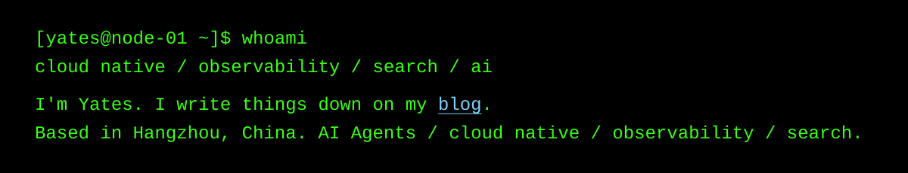

## Hi, I'm yinyu985

SRE focused on Kubernetes, observability, and production debugging.
I write incident notes and troubleshooting write-ups on my [blog](https://yinyu985.github.io).
I also build small tools for coding agents and browser workflows.

## Selected Projects

| Project | What it is |
|---|---|
| [FAPassword](https://github.com/yinyu985/FAPassword) | Chromium client for Apple Passwords. Reimplements native messaging and the SRP-6a handshake for secure autofill on macOS. |
| [agent-manager](https://github.com/yinyu985/agent-manager) | Local web UI to browse, search, and clean up coding-agent sessions. Single-file Node.js service with incremental scanning and path-safety checks. |
| [firstlight](https://github.com/yinyu985/firstlight) | Minimal Chrome new tab page built on Chrome Bookmarks, with Gist sync. TypeScript, Playwright E2E, privacy-focused. |

## Connect with me

## A Few Things I Usually Do

- Break down weird production issues and trace them to something concrete.
- Spend a lot of time around Kubernetes, logs, metrics, and search systems.
- Automate the boring parts so the next incident is slightly less annoying.
- Built [FAPassword](https://github.com/yinyu985/FAPassword), [firstlight](https://github.com/yinyu985/firstlight), [copy-context](https://github.com/yinyu985/copy-context), and [agent-manager](https://github.com/yinyu985/agent-manager).
